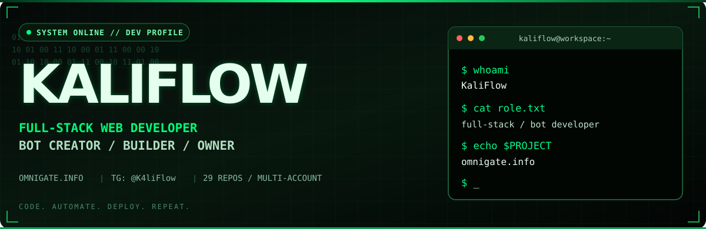
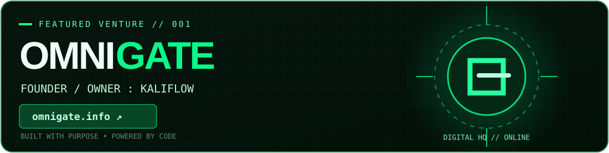

<div align="center">



<br/>

[](https://github.com/k45664253-byte)

<a href="https://omnigate.info"></a>
<a href="https://t.me/K4liFlow"></a>
<a href="https://github.com/k45664253-byte"></a>

<br/>


</div>

## `01 / identity` — Who am I?

```bash
┌──(kaliflow㉿workspace)-[~/profile]
└─$ cat identity.conf

NAME       = "KaliFlow"
GITHUB     = "@k45664253-byte"
ROLE       = "Full-Stack Web Developer"
SPECIALTY  = "Bot Creator & Automation Builder"
FOUNDER_OF = "OmniGate"
WEBSITE    = "https://omnigate.info"
TELEGRAM   = "https://t.me/K4liFlow"
REPOSITORIES_ACROSS_ACCOUNTS = 29 # self-reported, not this account's live count
STATUS     = "Building, automating, deploying"
```

<div align="center">

</div>

## `02 / venture` — OmniGate

<div align="center">
<a href="https://omnigate.info"></a>

**My digital venture: <a href="https://omnigate.info">omnigate.info</a>**  
Building my own corner of the internet — one release at a time.
</div>

## `03 / what-i-build`

| Track | Focus |
|:--|:--|
| 🌐 **Full-Stack Web Development** | Frontend, backend, APIs and database-connected experiences |
| 🤖 **Bot Creation** | Bots, chat integrations, practical automation and workflows |
| 🛠️ **Developer Tools** | Scripts, integrations and utilities for everyday problems |
| 🚀 **OmniGate** | Developing and growing my own web presence |

## `04 / tech-stack`

<div align="center">
<b>Developer technologies & tools</b><br/><sub>Selected tools associated with my development interests — not a claim of mastery in every item</sub>
<br/><br/>

<br/>

<br/><br/>


</div>

<div align="center">

</div>

## `05 / developer-footprint`

<div align="center">

### **29 repositories**
<sub>Self-reported combined total across different GitHub accounts; not the live count on this profile.</sub>

<a href="https://github.com/k45664253-byte?tab=repositories"></a>

### GitHub stats for this account


</div>

## `06 / activity`

<div align="center">

</div>

## `07 / contribution-snake`

<div align="center">
<picture>
<source media="(prefers-color-scheme: dark)" srcset="https://raw.githubusercontent.com/k45664253-byte/k45664253-byte/output/github-snake-dark.svg"/>
<source media="(prefers-color-scheme: light)" srcset="https://raw.githubusercontent.com/k45664253-byte/k45664253-byte/output/github-snake.svg"/>

</picture>
<br/>
<sub>Snake is generated by <a href="https://github.com/k45664253-byte/k45664253-byte/actions/workflows/snake.yml">GitHub Actions</a>; it appears after a successful run.</sub>
</div>

## `08 / contact`

<div align="center">
<a href="https://t.me/K4liFlow"></a>
<a href="https://omnigate.info"></a>
<br/><br/>
<code>$ echo "Code. Automate. Deploy. Repeat."</code>
<br/><br/>

</div>
